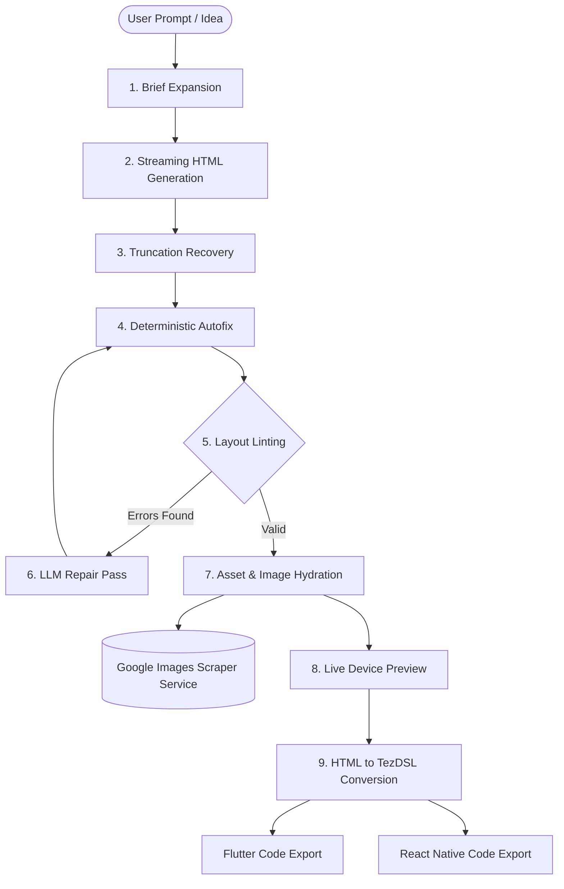
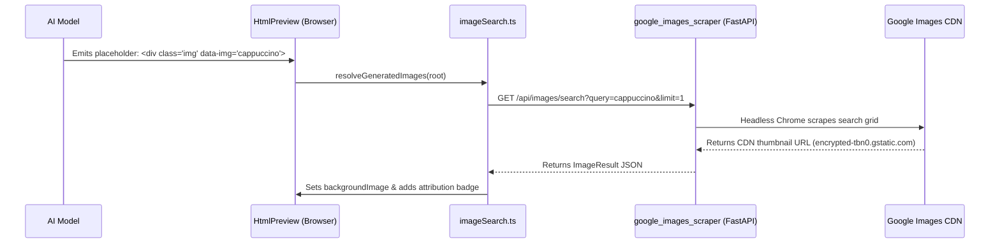

# TezMind UI Generation Architecture & Flow

This document details how TezMind turns a natural-language prompt into an interactive, production-ready mobile UI mockup and code export.

---

## 1. High-Level Architecture

TezMind operates entirely in the browser with a **Bring Your Own Key (BYOK)** model. All AI generation follows **Layout Contract v2**, streaming clean semantic HTML that is validated, repaired, hydrated, and convertible into cross-platform native code.



---

## 2. End-to-End Pipeline Stages

The generation engine in `packages/ai/src/pipeline.ts` is driven by a state machine with the following phases:

### Phase 1: Brief Expansion (`expanding`)
* **Input:** Raw user prompt (e.g., *"Food delivery app home screen"*), device dimensions, selected UI kit, and reference image (if provided).
* **Execution:** Calls `expand()` with a specialized structured JSON prompt.
* **Output:** An `ExpandedBrief` containing:
  - **Screen Archetype:** (e.g. `feed`, `dashboard`, `e-commerce`, `chat`, `profile`).
  - **Required Roles:** Key UI roles required for completeness (e.g., `app-bar`, `item-list`, `primary-cta`).
  - **Layout & Motion Strategy:** Spacing, density, and entry animations.
  - **Generator Prompt:** A detailed, unambiguous specification for the code model.

### Phase 2: Streaming Generation (`streaming`)
* **Execution:** Handled by `streamComplete()` using the user's active AI provider (Google Gemini, Anthropic Claude, OpenAI, or OpenRouter).
* **Prompt Construction:** Built by `buildHtmlSystemPrompt()`, which injects:
  - Layout Contract v2 rules (strict tag allowlists, CSS utility classes).
  - Selected UI Kit styling tokens (Material 3, Glassmorphism, Minimalism, Neumorphism, etc.).
  - Golden reference HTML component examples.
* **Streaming Chunks:** Incoming HTML tokens stream directly into the live preview window in real time.

### Phase 3: Truncation Recovery (`recovering`)
* **Problem:** Large or complex screens can hit the model's `maxOutputTokens` or get severed mid-tag.
* **Detection:** Checks `finishReason === 'MAX_TOKENS'` and calculates tag stack depth (`openTagDepth(html) > 0`).
* **Continuation:** If truncated, the pipeline automatically sends a continuation request with the existing partial HTML, seamlessly stitching the pieces together via `joinContinuation()`.

### Phase 4: Deterministic Autofix (`fixing`)
* **Execution:** `autofix()` cleans the HTML before any browser parsing:
  - Strips markdown code fences (````html````).
  - Closes unclosed tags.
  - Enforces required layout containers (`.screen`, `.scroll`).
  - Sanitizes forbidden elements (e.g., converts raw `` or `<svg>` to standard data-attribute containers).

### Phase 5: Layout Lint & Repair Loop (`repairing`)
* **Validation:** Runs `lint()` and `lintBounds()`:
  - Checks role completeness (e.g., did the screen include the required `primary-cta`?).
  - Verifies horizontal bounding constraints (ensuring elements don't overflow the device width).
* **Automated Repair Loop:**
  - If critical errors are found, the engine constructs a repair prompt (`buildRepairPrompt()`).
  - Up to 2 automated repair passes are executed with the LLM to fix the specific errors without regenerating the entire screen from scratch.

---

## 3. Asset & Image Discovery Flow

TezMind decouples HTML generation from external network dependencies during LLM synthesis:



1. **LLM Output:** The model emits semantic placeholders:
   ```html
   <div class="img" data-img="artisan cappuccino on wooden table" data-ratio="16:9"></div>
   ```
2. **Detection:** `imageSearch.ts` identifies unhydrated `.img[data-img]` elements in the DOM.
3. **Backend Service:** Queries `http://127.0.0.1:8000/api/images/search` hosted by **`google_images_scraper`**.
4. **Hydration:**
   - Background image is populated with the cached Google CDN URL (`encrypted-tbn0.gstatic.com`).
   - Attribution badge is attached (`Photo · Google Images`).
   - If the scraper service is not running, TezMind gracefully falls back to local colored gradients without breaking the layout.

---

## 4. Multi-Framework Code Generation (HTML → TezDSL → Native)

Once the HTML screen is stable:

1. **HTML to TezDSL:** `converter.ts` parses the HTML DOM and transforms it into the **TezDSL design tree** (a strict, host-agnostic layout tree with auto-layout nodes, flex directions, padding, and constraints).
2. **Flutter Codegen:** `packages/codegen-flutter` converts the TezDSL tree into idiomatic Dart `Widget` code (`Column`, `Row`, `Container`, `DecoratedBox`).
3. **React Native Codegen:** `packages/codegen-rn` converts the TezDSL tree into TypeScript React Native components (`View`, `Text`, `Pressable`, `StyleSheet.create`).
